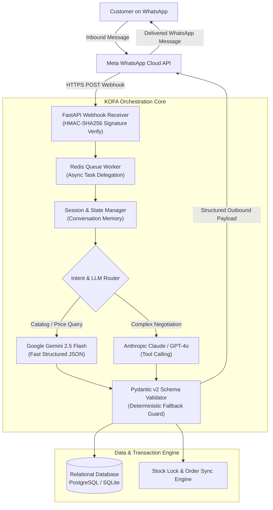

# KOFA: Autonomous AI Conversational Commerce & Inventory Platform 🚀

[](https://python.org)
[](https://fastapi.tiangolo.com)
[](https://redis.io)
[](https://developers.facebook.com)
[](https://azure.microsoft.com)
[](https://pydantic.dev)

An enterprise-grade conversational commerce and inventory orchestration engine designed for high-velocity merchant operations. **KOFA** bridges the gap between unstructured social commerce (WhatsApp Business API) and structured relational ERP/inventory backends using asynchronous webhooks, Redis session caching, and deterministic multi-model LLM routing (Google Gemini + OpenAI/Claude).

---

## 🏗️ System Architecture



---

## ⚡ Key Engineering Highlights

### 1. Zero-Downtime Webhook Plumbing & Signature Verification
* **Challenge:** Meta requires a `200 OK` webhook acknowledgment within 3 seconds, or it retries exponentially, triggering duplicated order confirmations and conversation race conditions.
* **Solution:** Decoupled ingress from execution. The lightweight FastAPI receiver validates the `X-Hub-Signature-256` HMAC header, acknowledges Meta in `< 80ms`, and offloads LLM processing to Redis background workers.

### 2. Strict Pydantic Schema Compliance & Hallucination Defense
* **Challenge:** Commercial transactions cannot tolerate hallucinated stock counts, invalid SKU prices, or corrupted JSON formats.
* **Solution:** All LLM outputs are piped into strict Pydantic models. Any payload failing validation immediately routes to a deterministic recovery prompt, guaranteeing 100% schema compliance before database write operations.

### 3. Redis Stateful Session Management
* Multi-turn order creation requires continuous conversational state (selected items, shipping address, payment status). KOFA maintains session TTLs in Redis to prevent state loss during intermittent network disconnects.

### 4. Dual-Persona Conversational Engine
* Includes toggleable persona routing supporting standard executive English as well as localized Nigerian English / Pidgin for high-conversion merchant-customer rapport.

---

## 📁 Repository Structure

```text
kofa/
├── chatbot/                     # FastAPI Backend & Orchestration Core
│   ├── main.py                  # API Ingress & Webhook Routes
│   ├── config.py                # Pydantic Settings & Environment Loading
│   ├── conversation.py          # State Machine & Session Logic
│   ├── intent.py                # LLM Intent Classifier & Prompt Routing
│   ├── inventory.py             # Stock Allocation & Reservation Engine
│   ├── payment.py               # Payment Verification & Checkout Handlers
│   ├── response_formatter.py    # WhatsApp Cloud API Message Serializer
│   └── routers/                 # Modular Domain Controllers (Delivery, Analytics, Expenses)
├── mobile/                      # React Native / Expo Merchant App
├── landing/                     # Merchant Onboarding Frontend
├── supabase/                    # Relational Schema & Migration Definitions
└── tests/                       # Automated Test Suite (Pytest)
```

---

## 🚀 Quickstart & Setup

### 1. Clone & Environment Setup
```bash
git clone https://github.com/juggernaut7777/kofa.git
cd kofa

# Create virtual environment
python -m venv venv
source venv/bin/activate  # On Windows: .\venv\Scripts\Activate.ps1

# Install dependencies
pip install -r requirements.txt
```

### 2. Configure Environment Variables
Copy `.env.example` to `.env` and fill in your development keys:
```bash
cp .env.example .env
```
```env
# Application Settings
DEBUG=False
PORT=8000

# WhatsApp Cloud API
WHATSAPP_PHONE_ID=your_phone_id_here
WHATSAPP_ACCESS_TOKEN=your_meta_token_here
WHATSAPP_VERIFY_TOKEN=your_webhook_verify_token

# AI Providers
GEMINI_API_KEY=your_gemini_api_key_here
ANTHROPIC_API_KEY=your_anthropic_api_key_here

# Redis & Database
REDIS_URL=redis://localhost:6379/0
DATABASE_URL=sqlite:///./kofa.db
```

### 3. Launch Development Server
```bash
uvicorn chatbot.main:app --host 0.0.0.0 --port 8000 --reload
```
* **API Ingress:** `http://localhost:8000`
* **Interactive Docs (Swagger):** `http://localhost:8000/docs`

---

## 👨‍💻 Architect & Lead Developer
**David (Nnaemeka) Ogbonnaya** — Staff Backend & AI Automation Engineer  
Abuja, Nigeria (WAT / GMT+1) | [GitHub Profile](https://github.com/juggernaut7777)
